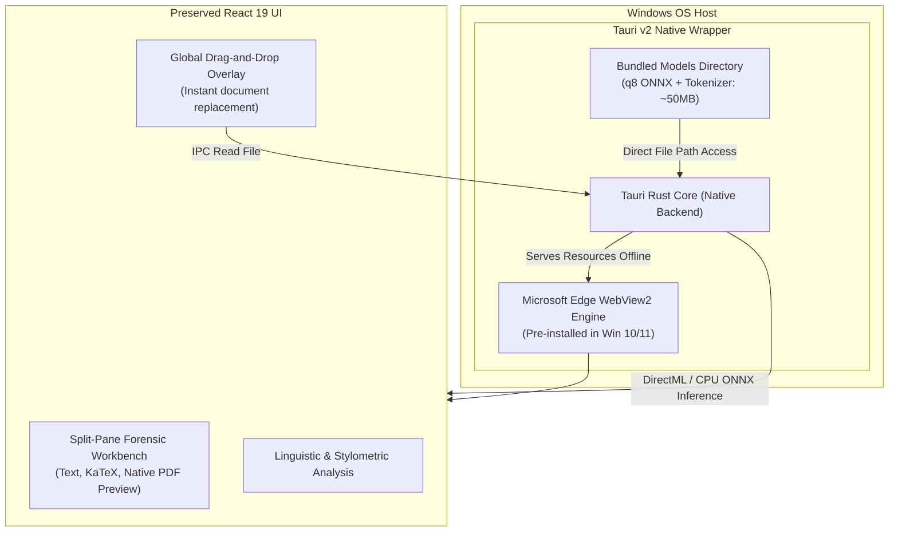

# Veritas Forensic: Windows Desktop Port Design Specification

**Target:** Windows 10 & 11 (x86_64, offline standalone executable)  
**Architecture:** Tauri v2 (Rust Core + Microsoft Edge WebView2)  
**UI Engine:** React 19 + Tailwind v4 + Lucide + KaTeX (Preserved identically)  
**Inference:** Offline Bundled ONNX Runtime (`Xenova/roberta-base-openai-detector`)  
**Build Target:** Cross-compiled via GitHub Actions Windows runners (x86_64)

---

## 1. System Architecture

### Key Technical Pillars
1. **Zero UI Disruption:**
   - The current React 19 frontend code (`src/`) remains 100% visually and functionally identical.
   - All KaTeX mathematical formula rendering, PDF.js split-pane viewing, and evidentiary dossier export features work as-is.
2. **100% Offline Standalone Guarantee:**
   - The app makes **0 network requests** to external APIs or Hugging Face hubs.
   - The quantized ONNX weights (`Xenova/roberta-base-openai-detector`, ~50MB) and tokenizer configuration are packaged directly into Tauri's bundle resource directory (`src-tauri/resources/models/`).
   - The calibration baseline (`humanCalibrationBaseline.json`) is embedded locally.
3. **Teacher-Centric Frictionless Drag-and-Drop:**
   - An active report no longer blocks loading new documents.
   - Dragging a new `.pdf`, `.docx`, `.tex`, or `.txt` file anywhere over the window triggers a full-window drop target overlay.
   - Dropping the file cancels background workers from the previous document, frees memory, and immediately starts analysis on the new paper.

---

## 2. Windows-Native Integration & IPC Bridge

The current web app relies on Express (`server.ts`) for neural inference at `/api/forensics/neural-classify`. In the Windows desktop port, this is superseded by Tauri IPC commands:

### IPC Command Interface

| Command | Direction | Payload | Return |
| :--- | :--- | :--- | :--- |
| `evaluate_neural_passages` | Frontend -> Rust | `{ passages: string[], model_path: string }` | `NeuralClassificationResult` |
| `read_document_buffer` | Frontend -> Rust | `{ path: string }` | Raw file bytes |
| `export_dossier_pdf` | Frontend -> Rust | `{ dossier_html: string, default_filename: string }` | File save confirmation |

---

## 3. Global Drag-and-Drop Replacement UX

### State Flow
1. **Idle / Viewing Submission:** The teacher is inspecting an evidentiary dossier for Paper A.
2. **`dragenter` Window Event:** 
   - A semi-transparent fluent overlay smoothly appears over the entire application window:
     > *"Drop new student manuscript here to analyze"*
   - The border pulses with a subtle forensic highlight.
3. **`dragleave` Event:** If the cursor exits the window, the overlay fades away without disrupting the active view.
4. **`drop` Event:**
   - The new file buffer is captured.
   - Prior calculation promises are aborted via `AbortController`.
   - The workbench state resets and immediately initiates the pipeline on Paper B.

---

## 4. Mac-to-Windows Cross-Platform Build Pipeline

Because local development takes place on macOS, the Windows x86_64 installer (`.exe` / `.msi`) is generated using automated GitHub Actions on real Windows hardware.

### Workflow Specification (`.github/workflows/build-windows.yml`)
1. **Trigger:** Push to `main` or manual trigger via GitHub Actions UI (`workflow_dispatch`).
2. **Runner:** `windows-latest` (Windows Server with MSVC x86_64 compiler).
3. **Steps:**
   - Checkout repository.
   - Set up Node.js / Bun and Rust (`stable-x86_64-pc-windows-msvc`).
   - Download/cache quantized ONNX model weights into `src-tauri/resources/models/`.
   - Run `bun run build` (builds the Vite React production bundle into `dist/`).
   - Run `bun tauri build` (compiles native Rust core and packages Windows NSIS `.exe` and `.msi` installers).
   - Upload installer artifacts for direct download.

---

## 5. Verification & Acceptance Criteria

1. **Air-Gap Verification:** Launch the built Windows app on an airplane-mode Windows machine; test `.pdf` and `.docx` ingestion and confirm neural calibration passes with live ONNX scores.
2. **UI Parity:** Verify side-by-side that fonts, KaTeX formulas, Dossier exports, and dark theme colors match the web application 1:1.
3. **Drop Target Verification:** Confirm dropping a new document on top of an already-evaluated document cleanly swaps to the new file without errors or memory leaks.
